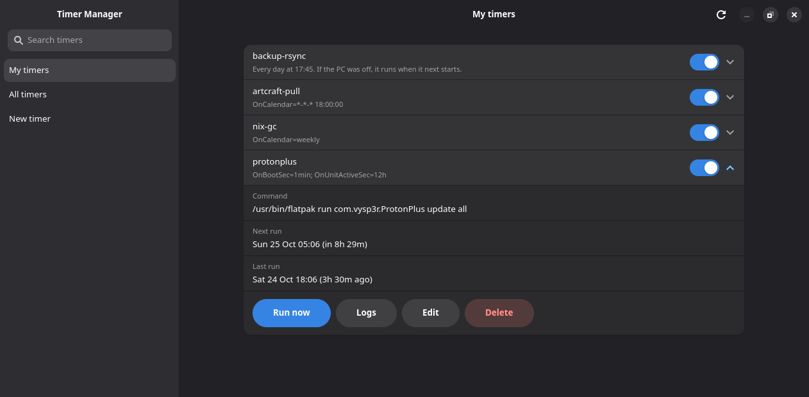
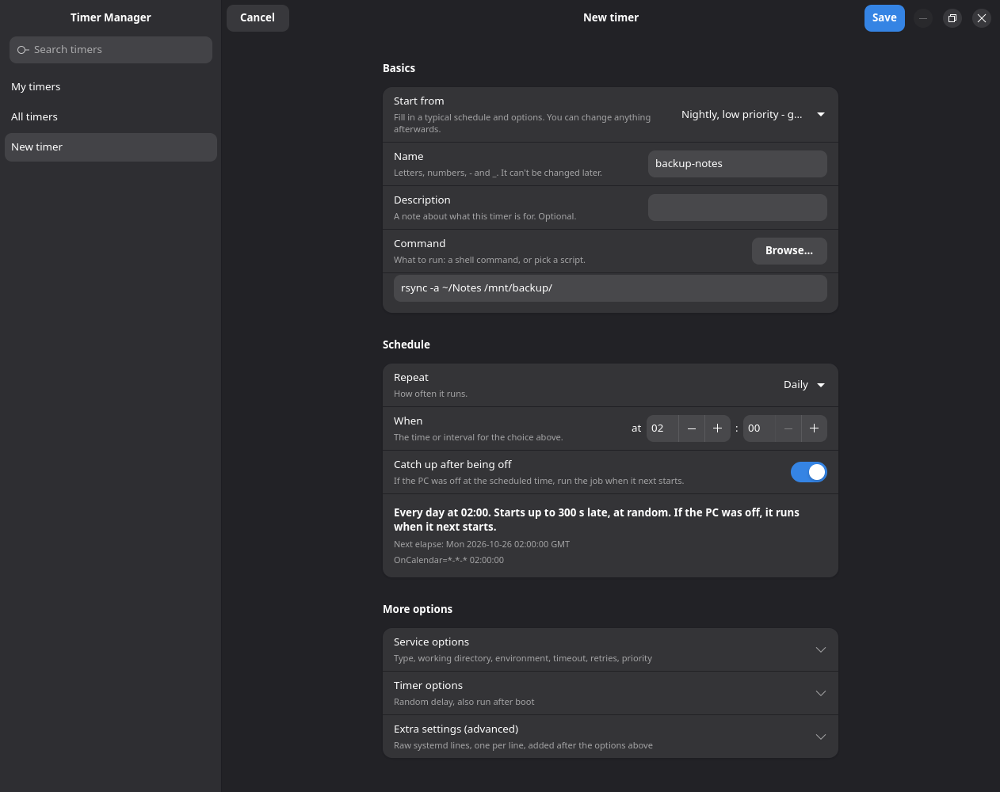

# Timer Manager

A small desktop app for creating and managing **systemd user timers** without
writing unit files by hand. It is a Rust app built with
[GTK 4](https://gtk.org) and [libadwaita](https://gnome.pages.gitlab.gnome.org/libadwaita/).

Timers made in the app are ordinary `.service` and `.timer` files in
`~/.config/systemd/user/`, so systemd runs them and they keep working if you
uninstall the app.

## Screenshots





## Features

- **Timer list** with an on/off switch, the schedule in plain English, the
  command it runs, and the next and last run time.
- **Run now** waits for the job to finish and shows whether it succeeded, with
  the output from that run.
- **New timer form** with presets, a script picker, and a live "next run"
  preview. Every option has a short plain-language description.
- **Service options:** type, working directory, environment variables, timeout,
  retry on failure, low priority.
- **Timer options:** random delay, also run after boot, catch up after being off.
- **Extra settings:** raw systemd lines for `[Unit]`, `[Service]` and `[Timer]`
  for anything the form doesn't cover. Duplicate settings are flagged.
- **Validated before saving:** `systemd-analyze verify` checks the generated
  files, so a typo can't leave a broken unit behind.
- **Safe editing:** only timers created by this app can be edited in the form.
  Other timers can be run, enabled, disabled, and opened in your text editor.
  Any timer with a unit file in `~/.config/systemd/user` can be deleted, after a
  confirmation. Timers shipped with the system can't be deleted.

## Requirements

- Linux with systemd (user instance) and `systemd-analyze`
- GTK 4.12 or newer and libadwaita 1.6 or newer
- To build it: Rust (edition 2024) and the GTK development files
  (`sudo dnf install gtk4-devel libadwaita-devel` on Fedora)

Optional, used when present:

- `xdg-terminal-exec` to open unit files when your default text editor runs in
  a terminal (like nano or Fresh), on desktops other than Plasma and GNOME

## Install on Fedora

Timer Manager is packaged in a [COPR](https://copr.fedorainfracloud.org/coprs/xariann/tools/)
repository for Fedora 44, 45 and Rawhide (x86_64). Enable it, then install:

```sh
sudo dnf copr enable xariann/tools
sudo dnf install timer-manager
```

Updates arrive with the rest of your system updates (`sudo dnf upgrade`). To
remove it, run `sudo dnf remove timer-manager`; timers you created stay in
`~/.config/systemd/user/`.

## Build from source

```sh
cargo build --release
install -Dm755 target/release/timer-manager ~/.local/bin/timer-manager
install -Dm644 packaging/io.github.xarianne.TimerManager.desktop ~/.local/share/applications/io.github.xarianne.TimerManager.desktop
```

## Usage

```sh
timer-manager          # My timers
timer-manager --all    # All user timers, including ones shipped with the system
timer-manager --new    # Open directly on the New timer form
```

## Status

Developed and used on Fedora. The
interface has been checked by hand on that setup only.

## License

GPL-3.0. See [LICENSE](LICENSE).
